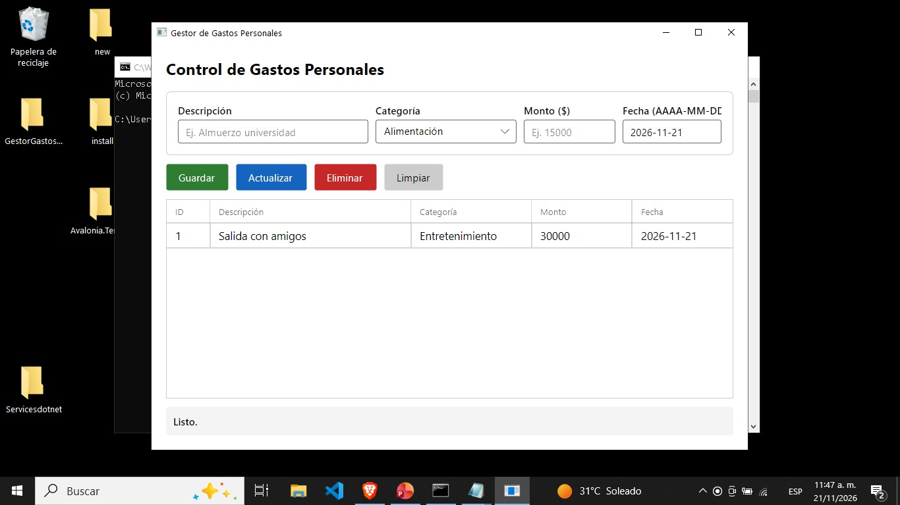
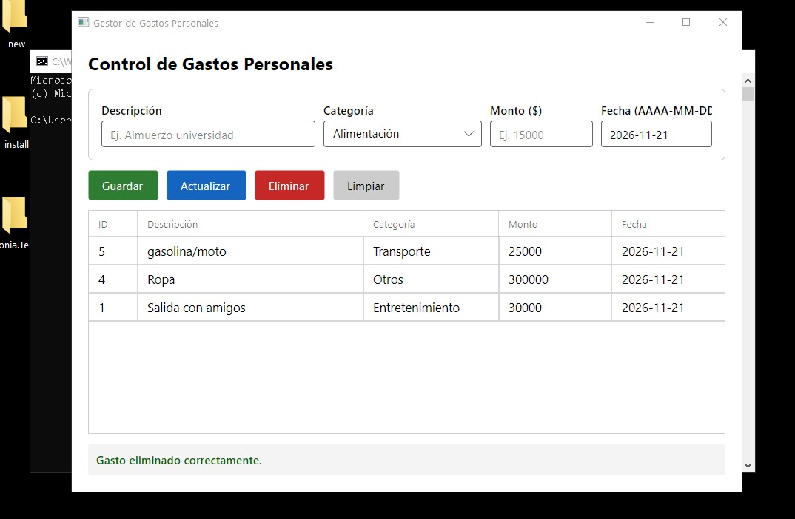

# Gestor de Gastos Personales (`GestorGastosApp`)

## 6.1. Información general
* **Nombre del proyecto:** Gestor de Gastos Personales (`GestorGastosApp`)
* **Estudiante:** Jean Paul Badillo Yanez
* **Descripción del software:** Aplicación de escritorio en C# y .NET 8 con interfaz gráfica en Avalonia UI y persistencia local en SQLite mediante ADO.NET para administrar gastos personales.
* **Problema o necesidad que resuelve:** Permite registrar, consultar, actualizar y eliminar gastos personales de forma rápida y local desde una ventana gráfica, sin depender de hojas de cálculo manuales.
* **Objetivo principal:** Demostrar la integración de Programación Orientada a Objetos, interfaz gráfica con Avalonia UI y acceso a datos con ADO.NET y SQLite en una aplicación de escritorio funcional.

## 6.2. Funcionalidades
* **Registrar gasto (Create):** Permite ingresar descripción, categoría, monto y fecha, validar los datos y guardar el registro en SQLite.
* **Consultar gastos (Read):** Muestra los gastos almacenados en una tabla (`DataGrid`) al iniciar la aplicación y tras cada operación.
* **Actualizar gasto (Update):** Permite seleccionar un registro de la tabla, editar sus valores y guardar los cambios en SQLite.
* **Eliminar gasto (Delete):** Permite eliminar un gasto seleccionado de la base de datos y actualizar la vista.
* **Validación y notificaciones:** Muestra mensajes en pantalla cuando hay datos inválidos o vacíos o al completar una operación, sin cerrar la aplicación.

## 6.3. Tecnologías utilizadas
* **Entorno y lenguaje:** .NET 8.0 SDK (`net8.0`) y C#
* **Interfaz gráfica:** Avalonia UI (`Avalonia`, `Avalonia.Desktop`, `Avalonia.Themes.Fluent`, `Avalonia.Controls.DataGrid` versión `11.2.1`)
* **Acceso a datos:** ADO.NET con `Microsoft.Data.Sqlite` versión `8.0.11`
* **Base de datos:** SQLite (`gastos.db`)

## 6.4. Estructura del proyecto

GestorGastosApp/
├── Data/
│   ├── ConexionSqlite.cs
│   └── GastoDao.cs
├── Models/
│   └── Gasto.cs
├── Services/
│   └── GastoServicio.cs
├── evidencias/
├── App.axaml
├── App.axaml.cs
├── GestorGastosApp.csproj
├── MainWindow.axaml
├── MainWindow.axaml.cs
├── Program.cs
├── .gitignore
└── README.md

* **Componentes principales:**
  * `Gasto` (`Models/Gasto.cs`): Representa la entidad de gasto y encapsula/valida la propiedad `Monto`.
  * `ConexionSqlite` (`Data/ConexionSqlite.cs`): Gestiona la conexión a SQLite y crea la tabla `Gastos` si no existe.
  * `GastoDao` (`Data/GastoDao.cs`): Ejecuta las operaciones CRUD mediante `SqliteCommand` y parámetros SQL.
  * `GastoServicio` (`Services/GastoServicio.cs`): Valida los datos ingresados y coordina las operaciones con `GastoDao`.
  * `MainWindow` (`MainWindow.axaml` y `MainWindow.axaml.cs`): Define la interfaz en XAML y conecta los eventos de los controles.
* **Aplicación de POO:** Organización por capas (`Models`, `Data`, `Services` y vista), encapsulamiento de propiedades, constructores y composición entre clases.

## 6.5. Instalación de dependencias
1. Instalar el **.NET 8.0 SDK** y verificar con `dotnet --version`.
2. Descargar o clonar el repositorio desde GitHub.
3. Restaurar los paquetes NuGet desde la carpeta del proyecto: `dotnet restore`.
4. Los paquetes utilizados son `Avalonia`, `Avalonia.Desktop`, `Avalonia.Themes.Fluent`, `Avalonia.Controls.DataGrid` (versión `11.2.1`) y `Microsoft.Data.Sqlite` (versión `8.0.11`).

## 6.6. Ejecución del programa
Desde la carpeta `GestorGastosApp`, ejecutar `dotnet restore` y luego `dotnet run`. La aplicación compilará y abrirá la ventana principal automáticamente.

## 6.7. Base de datos
* **Tabla:** `Gastos` con columnas `Id` (`INTEGER PRIMARY KEY AUTOINCREMENT`), `Descripcion` (`TEXT NOT NULL`), `Categoria` (`TEXT NOT NULL`), `Monto` (`REAL NOT NULL`) y `Fecha` (`TEXT NOT NULL`).
* **Conexión y CRUD:** Se gestionan mediante `SqliteConnection` y `SqliteCommand` parametrizados (`@descripcion`, `@categoria`, `@monto`, `@fecha`, `@id`) con `Microsoft.Data.Sqlite`.
* **Inicialización automática:** La base de datos (`gastos.db`) y la tabla `Gastos` se crean automáticamente al iniciar el programa si aún no existen (`CREATE TABLE IF NOT EXISTS`).

## 6.8. Evidencias de funcionamiento
1. **Registro:**  Se registra un gasto y se muestra la confirmación en la ventana junto con los datos en la tabla.
2. **Consulta:**  Se visualizan los registros almacenados cargados en el `DataGrid`.
3. **Actualización:**  Se modifica un gasto (por ejemplo, ajustando su monto) y se refleja el cambio en la tabla.
4. **Eliminación:**  Se elimina un gasto y se muestra el mensaje de eliminación correcta en la barra inferior.
5. **Validación:**  Al ingresar un monto inválido (como `-20000`), el programa avisa en pantalla sin cerrarse.
6. **Persistencia:**  Al ejecutar nuevamente `dotnet run`, los registros guardados continúan disponibles.

## 6.9. Problemas encontrados y soluciones
* **Comando `dotnet` no reconocido al inicio:** Se instaló el .NET 8.0 SDK y se abrió una nueva consola para verificar `dotnet --version`.
* **Plantilla `avalonia.app` no encontrada:** Se creó el proyecto base `net8.0` y se instalaron los paquetes de Avalonia UI `11.2.1`.
* **Incompatibilidad `NU1202` en `Microsoft.Data.Sqlite`:** Se ajustó la versión a `8.0.11` compatible con `net8.0`.
* **Error `CS1061` por `.WithInterFont()`:** Se retiró `.WithInterFont()` en `Program.cs` para compilar sin errores.

